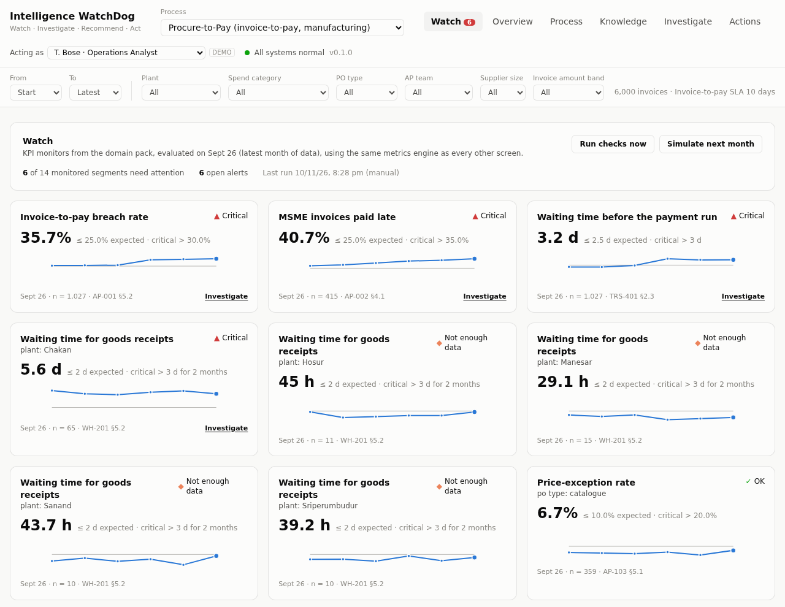
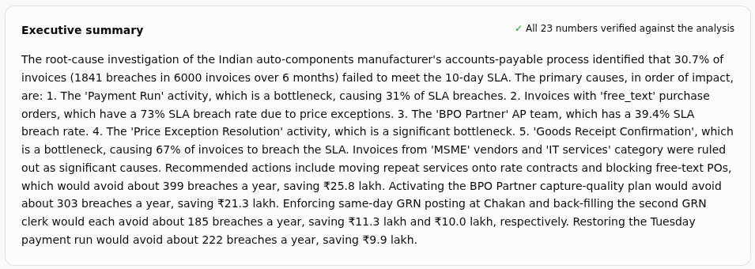
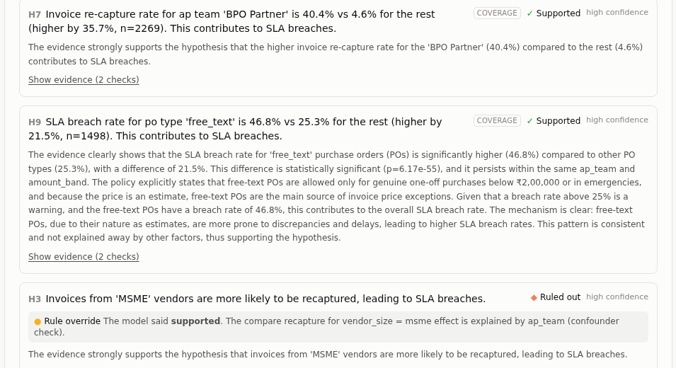

# Intelligence WatchDog

An AI operations analyst that **watches** business-process KPIs, **investigates** why they
drift, **recommends** fixes backed by evidence and ROI, and **acts** only with human approval.

**Watch → Investigate → Recommend → Act**, on two processes with one engine: insurance claims
and procure-to-pay.

> **Read first:** the [case study](docs/CASE_STUDY.md) (what and why, results, what broke) ·
> the [evaluation report](docs/evaluation_report.md) (every number, every failure) ·
> the [project brief](docs/PROJECT_BRIEF.md) (decisions D1–D47, scope, milestones).



*Procure-to-pay investigation, local 7B model: an executive summary whose every number is
verified against the analysis, and a decoy the model called "supported" that the confounder
rule ruled out (MSME suppliers: the effect is explained by AP team).*




## What it does

- **Watch:** KPI monitors with thresholds from the client's own policies. Alerts open,
  update and resolve themselves. New critical alerts are triaged automatically: ranked by
  severity and how far past threshold they are, and the top one investigated (within the
  daily budget; an identical earlier run is linked instead). Any alert is one click away.
- **Investigate:** a LangGraph workflow. Code scans for every significant pattern and runs
  every check, including confounder controls. The LLM writes hypotheses and judges the
  evidence. Rule overrides keep it honest in both directions.
- **Recommend:** only actions from the client's catalogue, each valued by a deterministic
  what-if on the event log (breaches avoided, net value a year) and cited to the policy that
  permits it.
- **Act:** propose → human approval by the right role → execution through an MCP server →
  hash-chained audit log → follow-up metric. Agents can never approve.

Around the loop, the platform an enterprise would ask for:

- **Open to read, sign in to run.** Anyone can browse every screen and replay showcase
  investigations without an account; running anything (an investigation, a question, SQL, an
  action) needs a sign-in, and only an admin creates accounts.
- **Accounts and role-based access.** Local accounts (scrypt-hashed passwords, HttpOnly
  session cookies). Platform roles (viewer, analyst, admin) gate what someone can do; a
  business role per process (e.g. Head of Claims, Treasury Head) gates what they can approve.
  Admins manage users and can act as another user for demos, recorded in the audit log.
- **Observability.** Every LLM call and API request is recorded: latency percentiles, tokens,
  errors, cache hits, the free-tier quota per model, and a timeline trace per investigation.
- **Cost control.** Repeated or near-identical policy questions are answered from a cache
  (invalidated when any document changes; never reused across different amounts). Simple
  requests can go to a cheaper model tier (`LLM_LIGHT_MODEL`), with the reason shown.
- **Replay instead of re-running.** Every investigation records its steps. An identical request
  on the same data, documents and models replays the recorded run in seconds with no model
  call. Admins pick showcase runs that anyone, read-only visitors included, can watch step by
  step.
- **Rate limits** on requests that spend tokens only: per person per hour, and for everyone per
  day, sized for a free model tier (`RATE_LIMIT_*` settings). Cache hits and replays are free.
- **Exploratory SQL, clearly labelled.** For questions no governed metric covers, analysts
  write (or have a model draft) one read-only SELECT over the pack's cases, events and
  feedback. It runs as a database role that can read nothing else, read-only, with a
  5-second limit and 500-row cap, and the result is marked "not a verified metric".
- **Three MCP servers.** Analytics (metrics, process mining, alerts, investigations,
  exploratory SQL) and Knowledge (policy search and documents) are read-only; Operations
  proposes and executes governed actions. Any MCP client gets the app's numbers, not a model's
  estimates.
- **Model comparison.** A page built from the saved evaluation runs, so every new run shows up.

## Results in one table

Scored against planted ground truth (generators plant root causes and decoys, with an exact
counterfactual per case). Full detail in the [evaluation report](docs/evaluation_report.md).

| | Insurance claims | Procure-to-pay |
|---|---|---|
| Investigations, 18-month data (local 7B × 3 seeds × all questions) | 15 | 12 |
| Mean recall of planted causes | 100% | 100% |
| Decoys accepted as causes | **0** in every run | **0** in every run |
| Earlier six-month data | 3 cloud models + local, 36 runs (6 refused by free-tier limits): 100% recall in every completed run, 0 decoys | local 7B, 9 runs: 100% recall, 0 decoys |
| Policy Q&A: answers citing a relevant passage | 95–100% by model | 100% |
| What-if vs exact counterfactual (18-month data) | 0.55–0.97 of truth (understates) | 0.64–1.17 of truth |

The 18-month data has five planted causes and three or four decoys per pack (`docs/PROJECT_BRIEF.md`
§5, §5b); the cloud models have not been re-run on it yet (free-tier quotas).

Every miss was over-caution (a real cause left inconclusive), never a decoy accepted; the
evaluation also found nine product defects, each fixed and re-measured
([notes](evaluation/results/NOTES.md)).

## Design principles

- **Deterministic numbers.** Every KPI comes from code or SQL; the LLM interprets, never
  calculates. Summaries are checked number by number.
- **Evidence-first.** Each finding links to the query results, process statistics and policy
  text behind it. Confounded effects cannot be reported as causes.
- **Approval enforced in the backend.** Write actions cannot run without a recorded human
  approval by an authorised role; the proposer cannot approve.
- **A process is configuration.** Each domain pack holds the process definition, metrics,
  monitors, actions, governance, policies and benchmark. See
  [adding a domain pack](docs/ADDING_A_DOMAIN_PACK.md).
- **Provider-agnostic, zero spend.** Local Ollama or free-tier Groq/Gemini, set in `.env`.

## Stack

FastAPI · LangGraph · PostgreSQL 17 + pgvector · SQL-native process mining · hybrid retrieval
(BGE embeddings + full-text, cross-encoder citation checks) · MCP · React + Vite + TypeScript +
Tailwind · Docker Compose

## Run locally

Requirements: Docker with Compose, [uv](https://docs.astral.sh/uv/), Node 24+.

```bash
cp .env.example .env          # then set POSTGRES_PASSWORD (and the same value in DATABASE_URL)
make secrets                  # generate MCP tokens, the mock system's key, account passwords
make up                       # build and start postgres, migrations, backend, frontend
make seed                     # both packs' data and policies, plus the admin and demo accounts
```

| What | URL |
|------|-----|
| App: sign in as `admin@watchdog.local` with `ADMIN_PASSWORD` from `.env` | http://localhost:5173 |
| API docs | http://localhost:8000/api/docs |
| Health | http://localhost:8000/api/health |

Other commands: `make eval DOMAIN=procure_to_pay` / `make eval-report` (evaluation),
`make watch` (evaluate monitors now), `make test`, `make lint`, `make check` (everything CI
runs), `make eval-retrieval`, `make psql`, `make logs`, `make down`. The `watcher` service
evaluates every pack's monitors hourly (`WATCH_INTERVAL_SECONDS`).

Demo accounts (one per governance role in each pack, e.g. `a.rao@demo.watchdog`, plus a
read-only `guest@demo.watchdog`) use `DEMO_PASSWORD`. Every `/api` route except health and
sign-in needs a session.

The LLM defaults to a local model through [Ollama](https://ollama.com)
(`ollama pull qwen2.5:7b`). Set `LLM_DEFAULT_MODEL` / `LLM_MODELS` in `.env` to use Groq or
Gemini instead.

## Connect an MCP client

Three servers, each on localhost only with its own token from `.env` (`make secrets`):

| Server | URL | Token | Tools |
|---|---|---|---|
| Analytics (read-only) | `http://localhost:8101/mcp` | `ANALYTICS_MCP_EXTERNAL_TOKEN` | metrics, process map, variants, bottlenecks, alerts, investigations, exploratory SQL |
| Knowledge (read-only) | `http://localhost:8102/mcp` | `KNOWLEDGE_MCP_EXTERNAL_TOKEN` | list, search and read policies and SOPs |
| Operations | `http://localhost:8103/mcp` | `OPERATIONS_MCP_EXTERNAL_TOKEN` | action catalogue, propose, execute approved actions (no approve tool) |

For example, with Claude Code:

```bash
for s in analytics:8101:ANALYTICS knowledge:8102:KNOWLEDGE ops:8103:OPERATIONS; do
  IFS=: read name port var <<< "$s"
  claude mcp add --transport http watchdog-$name http://localhost:$port/mcp \
    --header "Authorization: Bearer $(grep ^${var}_MCP_EXTERNAL_TOKEN= .env | cut -d= -f2-)"
done
```

Tools take an optional `domain` (`insurance_claims`, `procure_to_pay`). Operations calls are
recorded in the hash-chained audit log under the client's name. The Knowledge server returns
passages, not answers, so it spends no LLM tokens.

## Repository layout

```
backend/            FastAPI app (src/watchdog_backend), Alembic migrations, tests
  domain/           domain-pack schema and the active pack (per request / job / thread)
  analytics/        metrics engine (pack metrics → safe, parameterised SQL) and
                    SQL-native process mining (process map, variants, bottlenecks)
  generator/        synthetic data per pack, with planted root causes, decoys, ground truth
  knowledge/        document parsing, section-aware chunking, hybrid retrieval, cited answers
  llm/              provider-agnostic LLM gateway (Ollama, Groq, Gemini)
  investigation/    LangGraph investigation: scan → plan → evidence → assess → recommend →
                    summary, with confounder and evidence rules, what-if, number verification
  governance/       action rules (roles, separation of duties, approve-before-execute), audit
  identity/         accounts, sessions, platform roles (RBAC) and per-pack business roles
  observability/    LLM-call and API-request recording, summaries, investigation traces
  watch/            KPI monitors, alerts, action follow-ups, next-month simulator (demo)
  evaluation/       harness: investigations vs planted truth, Q&A, retrieval, what-if
  mcp_servers/      Analytics, Knowledge (read-only) and Operations (governed actions) MCP servers
  enterprise_mock/  stand-in for the client's systems of record
domain_packs/       one folder per process: pack, metrics, monitors, actions, governance,
                    policy documents, benchmarks (insurance_claims, procure_to_pay)
evaluation/         saved evaluation runs (results.jsonl per run) and notes on fixes
frontend/           React + Vite + Tailwind UI
docs/               case study, evaluation report, project brief, demo script, pack guide
.github/            CI: lint, migrate, test, migration round-trip, frontend build
```

> Status: **M8 in progress**: second domain pack, case study, accounts and RBAC,
> observability, cost controls and model comparison done; public deployment next.
